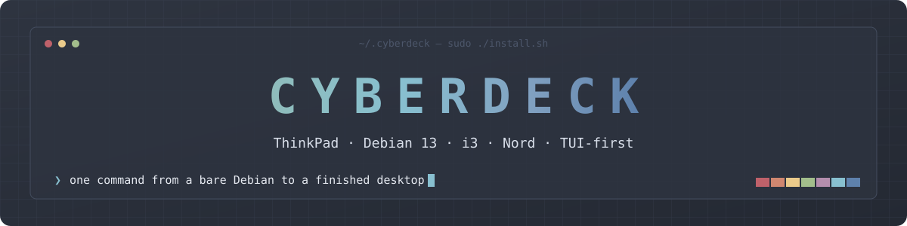
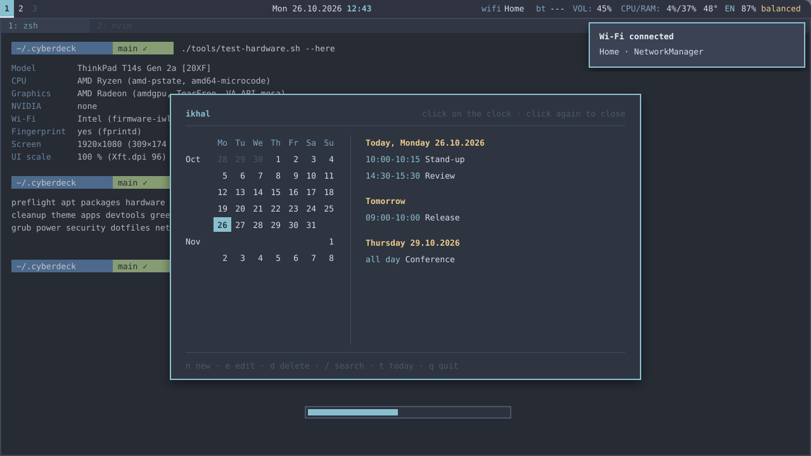
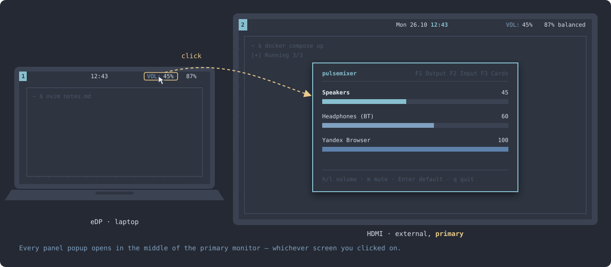
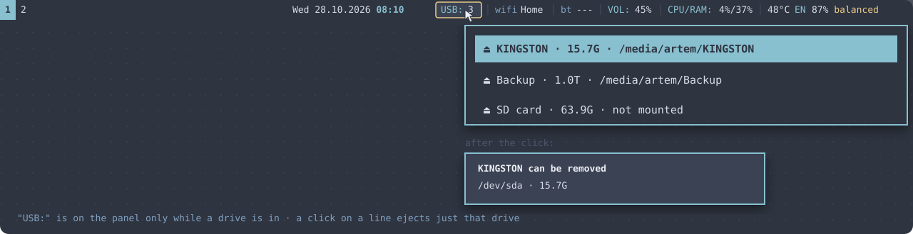
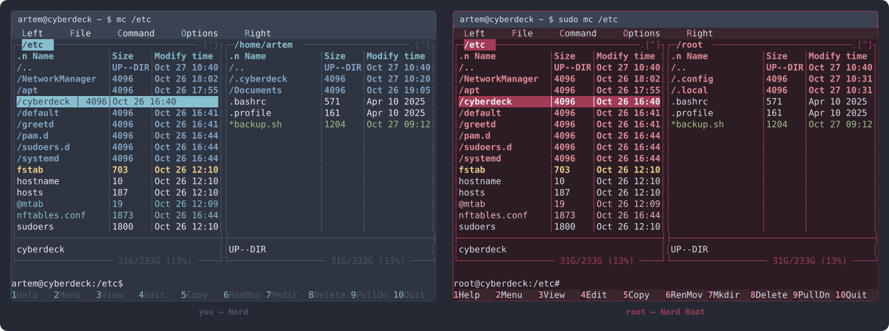
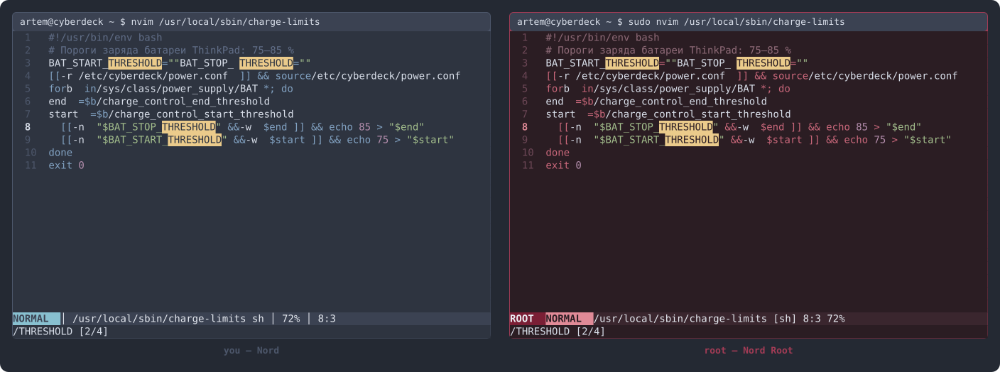
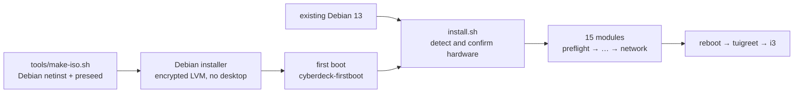

<div align="center">



**A keyboard-driven Debian 13 desktop for ThinkPads, installed with one command.**<br>
i3 · polybar · picom · kitty · zsh · Neovim — one Nord theme from GRUB to Qt dialogs.

[](https://www.debian.org/releases/trixie/)
[](https://i3wm.org)
[](https://www.nordtheme.com)
[](docs/hardware.md)
[](install.sh)
[](LICENSE)

[Install](docs/install.md) · [Hardware](docs/hardware.md) · [Desktop & keys](docs/desktop.md) · [Apps](docs/apps.md) · [Power](docs/power.md) · [Security](docs/security.md) · [Why these choices](docs/choices.md)

</div>

<br>

<p align="center">
  
  <br><sub>The layout, drawn to scale: polybar · kitty + Powerlevel10k · a click on the clock opens <code>ikhal</code> floating in the middle of the primary monitor, over whatever is open · dunst · the volume bar</sub>
</p>

## Why

Most dotfiles stop at copying configs. Cyberdeck takes a bare Debian — or a blank laptop — to a finished, tuned desktop and keeps it reproducible:

- 🧭 **One pass** — boot the Cyberdeck USB stick, answer the Debian installer's personal questions, walk away. The first boot installs everything and reboots into the login screen.
- 🔍 **Knows your ThinkPad** — detects CPU, GPU (AMD, Intel, NVIDIA hybrid), Wi-Fi chip, fingerprint reader and screen density, shows them for 30 s, and configures drivers, firmware, sensors and the UI scale accordingly.
- 🎨 **Nord, really everywhere** — GRUB, the boot splash, the LUKS prompt, the TTY palette, the login screen, GTK 2/3/4, Qt 5/6, the terminal, the lock screen, even PDF pages in the terminal.
- ⌨️ **TUI-first** — a click on any panel module opens its TUI floating in the middle of the primary monitor, over everything (fullscreen too); a second click closes it. See [The panel](#the-panel). Files in `mc` open Word, Excel and PDF right in the terminal.
- 🔋 **Laptop-grade power** — lock before every sleep, suspend-then-hibernate after 3 h, runtime PM, zram, VA-API video decoding, scripts that never wake the CPU for nothing.
- 🔐 **Verified, not trusted** — every third-party download is pinned by commit SHA or SHA-256, apt keys by fingerprint; nftables firewall, Docker ports on localhost, encrypted LVM by default.
- ♻️ **Idempotent** — run it again any time; every module can run alone; originals are kept, and `cyberdeck-restore` brings them back.

## The panel

Polybar is text, not icons, and every module is a door to a TUI. Whichever monitor's panel you click, the window opens **floating in the middle of the primary monitor** (the external one when it is connected, otherwise the laptop screen), on top of everything — fullscreen video included — and stays there when you switch workspaces. Another click on the module closes it; so does **Esc** wherever the program doesn't need Esc itself (`pulsemixer`, `s-tui`, and `nmtui` from its main screen) — in `htop`, `ikhal`, `bluetuith` and `jolt` Esc cancels searches and closes their dialogs, so there it stays theirs and `q` quits.

<p align="center">
  
</p>

<p align="center">
  
</p>

| Module | Click opens | Also |
|---|---|---|
| `USB:` *(only while a drive is connected)* | a menu under the panel — click a drive to eject just that one | |
| clock | `ikhal` — calendar and events | |
| network | `nmtui` | |
| bluetooth | `bluetuith` | right click — adapter on/off |
| `VOL:` | `pulsemixer` | scroll ±5 %, right click — mute |
| `CPU/RAM:` | `htop` | red above 90 % |
| temperature | `s-tui` — temperature, frequency, power graphs | red from 85 °C |
| battery | `jolt` — what drains the battery, battery health | click the profile name — next power profile |

Size: 58 % × 65 % of the monitor, so the same popup fits a 13" Full HD and a 32" 4K screen. More: [docs/desktop.md](docs/desktop.md#polybar-left-to-right).

## Root in burgundy

When you work as root, you see it at once. `mc` and Neovim run as root — `sudo mc`, `sudo nvim`, `su -`, F4 in a root `mc`, `visudo`, `crontab -e`, and `sudoedit` too — switch to **Nord Root**: the same Nord layout with burgundy backgrounds, frames and accents, and a red `ROOT` badge in Neovim's status line.

<p align="center">
  
  
  <br><sub>Rendered cell by cell from the theme files themselves (<code>tools/render-themes.py</code>), not screenshots.</sub>
</p>

Root gets its own plugin-free Neovim config and its own `mc` settings, owned by root — root never runs files from your home directory. In a text console without 24-bit colour the same idea falls back to 16 colours: red accents instead of cyan. Details: [docs/apps.md](docs/apps.md#root-in-burgundy).

## Quick start

**From a USB stick** — a fresh laptop, Debian and Cyberdeck in one pass:

```sh
sudo apt install xorriso curl gpg python3 grub-common
tools/make-iso.sh                         # → cyberdeck-13.x.y-amd64.iso (official netinst + Cyberdeck)
sudo cp cyberdeck-*.iso /dev/sdX && sync  # sdX is the stick itself, not a partition
```

Boot it (F12 on a ThinkPad) and pick **Install Cyberdeck**. You are asked only what is yours: language, country, keyboard, time zone, computer name, Wi-Fi, user, disk and passwords.

**On an existing Debian 13** without a desktop environment:

```sh
sudo apt install git
git clone https://github.com/<you>/cyberdeck ~/.cyberdeck && cd ~/.cyberdeck
sudo ./install.sh        # ~20–40 min
sudo reboot
```

> [!TIP]
> `./install.sh --check` tells you up front whether apt can find every package, and `tools/test-vm.sh` runs the whole installation in a QEMU virtual machine before you touch the laptop.

More: [all install.sh options](docs/install.md#running-installsh) · [the installation image](docs/install.md#installation-image) · [language and region](docs/install.md#language-and-region).

## Supported hardware

The installer detects the hardware, shows it, and lets you change any line before it configures anything:

```
  Detected hardware

    Model        ThinkPad T14 Gen 3 [21AH00]
    CPU          Intel Core (intel_pstate, intel-microcode, thermald)
    Graphics     Intel graphics (modesetting, VA-API iHD/i965)
    NVIDIA       none
    Wi-Fi        Intel (firmware-iwlwifi)
    Fingerprint  yes (fprintd)
    Screen       2880x1800 (302×189 mm)
    UI scale     150 %  (Xft.dpi 144)

  Enter — change   ·   continuing with these settings in 30 s…
```

| Hardware | What Cyberdeck sets up |
|---|---|
| **AMD Ryzen + Radeon** | amd64-microcode, `amd_pstate=active` (EPP), amdgpu with TearFree, mesa VA-API, k10temp |
| **Intel Core + Intel graphics** | intel-microcode, intel_pstate + thermald, modesetting + picom vsync, iHD/i965 VA-API, coretemp |
| **Discrete NVIDIA** | the driver `nvidia-detect` picks, PRIME offload with `prime-run <program>`, video memory kept across sleep and hibernation, nouveau for cards the driver dropped |
| **HiDPI (2.2K – 4K)** | one scale for the whole session: fonts, GTK, Qt, cursor, panel, lock screen, OSD, GRUB at native resolution, console font |
| **Wi-Fi** | Intel, Qualcomm/Atheros, Realtek, MediaTek, Broadcom firmware |
| **Fingerprint** | fprintd + PAM: password first, then the finger — in sudo, polkit and on the lock screen |

The reference machine is a **T14s Gen2 AMD**. Everything else is detected, not hard-coded — see [docs/hardware.md](docs/hardware.md); check what your machine would get with `tools/test-hardware.sh --here`.

## What's inside

| Area | Components |
|---|---|
| **Session** | greetd + tuigreet → i3 · picom · polybar (70 % opaque) · rofi · dunst · xob bars for volume, brightness, mic and keyboard backlight |
| **Terminal** | kitty (wallpaper under a 95 % tint) · zsh + Oh My Zsh + Powerlevel10k · fzf · zoxide · eza · bat · delta |
| **Files & docs** | mc · Docxy/Xlsxy for Word and Excel in the terminal · pdf-tui with Nord-tinted pages · timg · mpv · cmus |
| **Editor** | Neovim 0.11 with LSP (mason), Treesitter, completion, format-on-save, Kubernetes schemas for YAML · VS Code |
| **Dev & ops** | Docker CE · kubectl · k9s · helm · stern · kubectx · OpenTofu · gh · lazygit · uv · mise · direnv |
| **System** | NetworkManager · PipeWire · bluetuith · power-profiles-daemon · fwupd · autorandr · udiskie · greenclip · Flameshot · Hiddify |
| **Boot** | Nord GRUB theme · plymouth *cubes* in Nord with the LUKS prompt · Nord console palette from the kernel command line |

Why each of these was picked: [docs/choices.md](docs/choices.md).

## Keys

| Key | Action |
|---|---|
| `Win+Enter` | terminal |
| `Win+Space` · `Win+Tab` | applications · windows |
| `Win+n` · `Win+e` · `Win+w` | mc · Neovim · browser |
| `Win+h/j/k/l` (`+Shift`) · `Win+1…0` | focus (move) · workspaces |
| `Win+Shift+V` · `Win+.` · `Win+=` | clipboard history · emoji · calculator |
| `Win+Shift+p` | monitors: arrange, rotate, pick the main one — remembered per set of monitors |
| `Print` | screenshot with annotations |
| `Win+Esc` · power button | lock · power menu |
| `Fn+4` | sleep → hibernate after 3 h |
| `LAlt+LShift` | EN ⇄ RU |

All of them: [docs/desktop.md](docs/desktop.md#i3-keys-win--mod).

## How it works



`install.sh` reads `/etc/cyberdeck/hardware.conf` (or creates it), then runs the modules in order. Each module is a plain bash file in [`modules/`](modules) and can be run alone with `--only`. System files are copied from [`system/`](system); user configs are symlinked from [`config/`](config), so editing the repository changes the live desktop.

```
install.sh              entry point (root)
lib/                    shared functions, package lists, hardware detection, pinned versions
modules/NN-*.sh         installation steps
system/                 system files (copied into /)
config/                 user configs (symlinked into ~/.config)
bin/                    cyberdeck-* utilities (→ /usr/local/bin)
iso/                    preseed, late_command and the first-boot service for the image
tools/                  check.sh · test-hardware.sh · test-vm.sh · make-iso.sh · render-themes.py
docs/                   the documentation
```

## Testing

- `tools/check.sh` — shellcheck, Python syntax, nftables and apt configs, mc rules, executable bits, hardware detection on sample ThinkPads.
- `tools/test-hardware.sh` — detection on fake `/sys` of a T14s AMD, T14 Intel 2.8K, P1 Intel + NVIDIA 4K, P53 NVIDIA-only, T14 AMD + Qualcomm, E495 and a VM.
- `tools/test-vm.sh` — the full installation in QEMU, reboot, and checks of the result.
- `tools/render-themes.py` — redraws the theme pictures in `docs/assets` from the mc skins and the Neovim colour scheme.
- GitHub Actions run the checks and the package availability test on every push and weekly; the VM run is manual.

## Credits

Cyberdeck stands on a lot of good work: the [Nord](https://www.nordtheme.com) palette; the kitty, zsh, picom and lock screen settings from [sasha-sup/dotfiles](https://github.com/sasha-sup/dotfiles); the [Nordic](https://github.com/EliverLara/Nordic) GTK and Kvantum themes; the [cubes](https://github.com/adi1090x/plymouth-themes) plymouth theme by adi1090x (GPL-3.0, recoloured); ideas from [NvChad](https://github.com/NvChad/NvChad); and [i3lock-color](https://github.com/Raymo111/i3lock-color), [xob](https://github.com/florentc/xob), [tuigreet](https://github.com/apognu/tuigreet), [Docxy](https://github.com/yeroo/docxy), [pdf-tui](https://github.com/WindustH/pdf-tui), [bluetuith](https://github.com/darkhz/bluetuith), [jolt](https://github.com/jordond/jolt), [greenclip](https://github.com/erebe/greenclip). Third-party files in this repository are listed in [THIRD_PARTY.md](THIRD_PARTY.md).

## License

[MIT](LICENSE) for Cyberdeck's own code and configs. The bundled plymouth theme keeps its GPL-3.0 licence — see [THIRD_PARTY.md](THIRD_PARTY.md).
